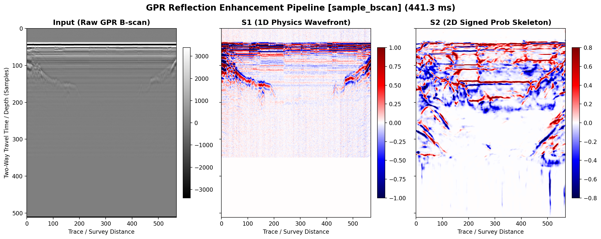

<div align="center">

# 📡 PolarGPR: Agile & Parameter-Tunable GPR Reflection Extraction
### Lightweight Neural Reflection Layer Recovery with On-the-Fly Huygens Simulation (Wave Superposition, Hyperbolas & Trailing Coda)

[](https://opensource.org/licenses/MIT)
[](https://www.python.org/)
[]()
[-brightgreen.svg)]()
[](https://onnxruntime.ai/)
[](https://www.reddit.com/r/geophysics/comments/1r3f83m/showcase_automating_100mhz_gpr_signal_recovery_nn/)

[English](README.md) | [中文说明](#-中文技术概要与项目背景)

</div>

---

## 📖 Background & Motivation

> *"A lightweight, parameter-tunable reflection extraction model trainable in a few hours on consumer hardware (e.g. Mac mini), open-sourced for community reference and feedback."*

### 1. Project Origins & The Intuition Behind the Simulation
I am a developer with a background in audio, array signal processing, and neural network application engineering—**not a trained geophysicist**. A few months ago, a contact shared a challenging set of water radar profiles from a **lake survey plagued by heavy multi-path ringing and reverberation** to explore potential collaboration. In such aquatic surveys, extreme dielectric contrasts between water, water-bottom sediment, and bedrock cause severe multiple reflections (ringing bands) that mask true structural horizons.

Rather than pursuing an elusive "one-size-fits-all universal model," the core goal became building an **agile, lightweight workflow where physical simulation parameters can be easily tailored to target field requirements, trained in hours on consumer hardware, and immediately applied to inspect B-scans**.

During the exploratory phase, I initially tried full-wave numerical solvers like **gprMax**. However, FDTD differential solvers proved far too slow—synthesizing even a modest dataset took days or weeks. 

While visually inspecting B-scan radargrams, an intuition emerged: the macroscopic hyperbolic events, diffraction tails, and interference patterns strongly resembled **ripples propagating and interfering on a water surface**. Guided by this acoustic analogy, I built a simplified, vectorized **Huygens principle propagator** that directly simulates three core physical elements:
1. **Wavefront Superposition**: Simulating complex undulating layer interfaces and boundary interference.
2. **Diffraction Hyperbolas**: Accurately modeling travel-time hyperbola geometry ($t = \sqrt{t_0^2 + 4x^2/v^2}$).
3. **Trailing Coda Waves**: Reproducing the variable-length oscillating reverberations that follow the primary reflection.

This reduced synthesis time from hours to milliseconds, enabling real-time on-the-fly streaming directly into PyTorch without caching static datasets.

While the preliminary results successfully recovered continuous reflection boundaries, the exploratory collaboration did not continue. Rather than shelving the code, I am open-sourcing the entire pipeline to share these observations with the community.

### 2. Community Feedback on Reddit
I previously shared some early processed profiles on Reddit ([r/geophysics showcase thread](https://www.reddit.com/r/geophysics/comments/1r3f83m/showcase_automating_100mhz_gpr_signal_recovery_nn/)). The post sparked interesting discussions with domain practitioners. Notably, a community contact tested the inference pipeline against a challenging, coarsely sampled field dataset (`100 MHz`, `dt = 2 ns`, `dx = 1 m`).

The test highlighted several subtle field wavefield characteristics (such as discontinuous horizontal ringing bands, trace-to-trace amplitude variations, and trailing-edge frequency shifts) that pure data-driven processing without in-situ survey context cannot easily explain.

### 3. Why Open Source?
Because I lack formal geological and field radar survey training, I cannot authoritatively interpret whether certain subtle wavefield features correspond to genuine stratigraphic interfaces, local soil moisture variations, or antenna coupling artifacts. 

I am unsure whether this preliminary pipeline holds lasting practical value for real-world geophysics workflows. I am open-sourcing the complete code, lightweight ONNX weights (~3 MB), and interactive tools in hopes that:
- It may serve as a useful reference or baseline for researchers exploring low-SNR GPR enhancement.
- Practicing geophysicists and radar engineers can evaluate the results critically and provide constructive feedback.
- It encourages open dialogue on bridging traditional signal processing with modern learning-based architectures in near-surface geophysics.

---

## 🎯 Problem Statement

Legacy and deep GPR B-scan data typically suffer from three major degradation factors:

1. **Antenna Direct Coupling & Horizontal Clutter**: Dominant horizontal stripes in shallow time-slices saturate dynamic range and obscure top-layer interfaces.
2. **Exponential Path Attenuation**: Reflections from deep soil strata, utilities, and cavities drop below the background speckle noise level.
3. **Ambiguity in Boundary Polarity**: Conventional intensity thresholding loses critical phase orientation (e.g., distinguishing positive reflection at void ceilings from negative reflection at metallic pipes or water interfaces).

```
[Raw B-scan Profile]
        │
        ▼ (1D Physics Prior)
[Background Removal + SVD Clutter Filter + 98% Dynamic AGC + Hilbert Analytic Signal]
        │
        ▼ (2D Deep Feature Extraction)
[Phase Manifold & Dilated Spatial Receptive Field Network]
        │
        ▼
[Continuous Signed Probability Reflection Skeletons: P(+) - P(-)]
```

---

## 🖼️ Visual Comparison

Below is the end-to-end transformation on a real-world B-scan field profile:



* **Input (Raw GPR B-scan)**: Target horizons and hyperbolic events are heavily masked by horizontal striping and high-frequency scattering noise.
* **S1 (1D Physics Wavefront)**: Baseline DC drift, horizontal common-mode clutter, and dynamic range discrepancies are normalized while strictly preserving wavelet phase polarities.
* **S2 (2D Signed Prob Skeleton)**: Non-coherent noise is completely suppressed; subtle structural interfaces and diffraction apexes glow as continuous, high-confidence skeletons with crystal-clear polarity ($P_{pos} - P_{neg}$).

---

## 🔬 Core Algorithm & Architecture

The architecture bridges the gap between **analytical wavefield physics** and **spatial deep learning**:

### 1. 1D Physics-Informed Preprocessing (`core/filter_1d.py`)
* **Background Trace Subtraction**: Eliminates direct coupling waves via cross-profile mean-trace deduction: $\tilde{s}(t, x) = s(t, x) - \frac{1}{N} \sum_{i=1}^N s(t, x_i)$.
* **Optional SVD Rank-1 Clutter Filter**: Separates stationary horizontal noise from dipping stratigraphic horizons.
* **Robust Percentile AGC**: 98th-percentile envelope clipping to avoid saturation from near-surface anomalies.
* **Hilbert Analytic Transform & Phase Analysis (Tackling Massive Dynamic Range)**:
  * *The Challenge*: GPR signals undergo severe path attenuation and dispersion, creating an extreme dynamic range where near-surface direct waves are orders of magnitude stronger than deep reflection events. Conventional CNNs trained directly on raw amplitudes tend to have their gradients dominated by shallow features, while faint deep reflections are easily suppressed.
  * *The Phase Solution*: By taking the Hilbert transform along the depth/time axis, we form the analytic signal $z(t) = s(t) + i\mathcal{H}[s(t)] = A(t)e^{i\phi(t)}$. Crucially, we decompose this into:
    * **Unit Phasors**: $\frac{z_r(t)}{A(t)} = \cos\phi(t)$ and $\frac{z_i(t)}{A(t)} = \sin\phi(t)$, which normalize signal energy to unity everywhere while preserving precise phase orientation.
    * **Instantaneous Frequency**: $\omega(t) = \frac{d\phi}{dt}$ tracking local wavelet oscillations.
  * *The Impact*: This shifts the network's attention away from depth-dependent absolute amplitude scales toward **localized phase singularities (wavefield sign inversions at dielectric contacts) and lateral spatial coherence**.

### 2. 2D Spatial Dilated Convolution Engine (`core/detector_2d.py`)
* **Phase-Driven Stage 2 Input**: Stage 2 directly ingests the normalized phasor channels $[\cos\phi, \sin\phi]$ coupled with Stage 1's preliminary polarity probabilities, ensuring feature extraction is inherently invariant to overall signal decay.
* **Dual-Channel Polarity Separation**: The network separately predicts probabilities for:
  * **Positive Phase ($+$)**: Transitions from high to low dielectric constant (e.g., void ceilings, dry bedrock boundaries).
  * **Negative Phase ($-$)**: Transitions from low to high dielectric constant (e.g., metal utilities, water-filled anomalies, wet clay beds).
* **Global Context Bottleneck**: Employs dilated convolutions with varying dilation rates ($d=1, 2, 4$) to capture wide hyperbolic tails without downsampling resolution.
* **Signed Skeleton Synthesis**: $P_{signed} = P_{pos} - P_{neg} \in [-1, 1]$.

### 3. Engineering Philosophy: Agile Targeted Adaptation over Blind Generality
* **From gprMax to Huygens Ripples**: Conventional full-wave solvers (like gprMax) are indispensable for rigorous forward modeling, but their computational overhead creates a bottleneck for training data generation. Adopting an analytical, vectorized Huygens formulation trades off fine-grained scattering physics for extreme synthesis speed (~milliseconds per slice).
* **On-the-Fly Physics Streaming**: Training samples are synthesized dynamically in memory during data loading. There is zero disk I/O bottleneck, and the network never encounters the exact same profile twice.
* **Rapid Convergence on Consumer Hardware**: Tested on a standard **Mac mini (M2, 24GB)**, the entire two-stage network **converges within just a few hours**.
* **Parameter Alignment**: The synthetic propagator should be configured to approximate target field parameters (notably sampling interval `dt`, center frequency, and trace spacing `dx`). While the model has reasonable tolerance to variations, a severe scale mismatch (e.g., an order-of-magnitude difference in wavelet period or hyperbolic curvature) can impair reconstruction. The true practical value lies in **fast, customized turnaround and lightweight deployment**, rather than an all-in-one universal model.

### 4. 🏕️ Practical In-Situ Field Work Workflow
This architecture is intentionally tailored for field geophysicists and utility surveyors:
1. **Daytime Acquisition**: Collect your survey lines. Note down antenna center frequency ($f_c$), temporal sampling interval ($dt$), and spatial trace spacing ($dx$).
2. **Evening Training on a Laptop / Mac mini**: Spin up `train.py` on a portable machine with your survey's physical parameters. Because the simulation streams in memory, the model converges in **2–3 hours** without needing an enterprise GPU cluster.
3. **In-Situ Next-Day Enhancement**: Feed the raw B-scans into `demo.py` or `app.py` (<500ms per line) to visualize clean reflection horizons and inform next-day drilling or trenching decisions.

---

## 🔧 Where to Customize Simulation Parameters

You can adjust the simulation parameters to match your antenna and geology either via **CLI arguments** or **directly in code**:

| Parameter | Meaning & Geological Context | Common Values | CLI Argument (`train.py`) | In-Code Location (`train.py`) |
| :--- | :--- | :--- | :--- | :--- |
| **`dt`** | Temporal sampling interval | `1.0e-9` (1 ns), `2.0e-9` (2 ns) | `--dt 2.0e-9` | `SyntheticGPRGenerator.__init__` line ~94 |
| **`freq`** | Antenna center frequency | `100e6` (100 MHz), `500e6` (500 MHz) | `--freq 100e6` | `SyntheticGPRGenerator.__init__` line ~94 |
| **`dx`** | Trace spatial spacing (survey step) | `0.05` (5 cm), `0.2` (20 cm), `1.0` (1 m) | `--dx 0.05` | `SyntheticGPRGenerator.__init__` line ~94 |
| **`v_min / v_max`** | Subsurface propagation velocity (m/ns) | Water: ~0.033, Wet clay: 0.06-0.08, Soil: 0.08-0.13, Rock: 0.12-0.15 | `--v_min 0.08 --v_max 0.13` | `SyntheticGPRGenerator.__init__` line ~97 |
| **`ringing_level`** | Multi-path reverberation level | `normal` (land/soil), `heavy` (water/lakebed surveys) | `--ringing_level heavy` | `generate_random_profile()` line ~135 |

---

## ⚡ Performance Benchmarks

Engineered for resource-constrained field hardware, edge devices, and modest cloud VPS instances:

| Metric | Measured Value | Remarks |
| :--- | :--- | :--- |
| **Model Footprint** | **~3.0 MB** (`.onnx`) | Extremely lightweight |
| **Mac (Apple Silicon CPU)** | **~340 ms** | 512 × 400 B-scan slice (~200k samples) |
| **1-Core Cloud VPS (ARM CPU)** | **~380 ms** | 100% CPU inference without GPU |
| **Peak Memory Consumption** | **< 60 MB** | Zero GPU / VRAM requirements |

> [!NOTE]
> **Input Scale & Latency Scaling**: Because the network is fully convolutional (with dynamic spatial inputs), processing latency and memory scale linearly with profile dimensions ($N_t \times N_x$, Time Samples × Traces). A typical standard slice ($512 \times 400 \approx 200\text{k}$ samples) processes in ~340ms, while longer continuous survey profiles (e.g. 2,000+ traces) will scale proportionally.

---

## 🚀 Quickstart

### 1. Installation
Clone the repository and install the lightweight dependencies:

```bash
git clone https://github.com/userLlamma/PolarGPR.git
cd PolarGPR
pip install -r requirements.txt
```

### 2. Run Single-File Demo
Process an included high-contrast profile:

```bash
# Fast run on sample B-scan array (.npy)
python demo.py --input data/sample/sample_bscan.npy --output_dir results

# Or directly process raw SEG-Y (.sgy) radargram (~400ms)
python demo.py --input data/sample/sample_bscan.sgy --output_dir results
```
Outputs:
* `results/<name>_comparison.png`: 3-panel comparative diagnosis plot.
* `results/<name>_skeleton.npy`: Full-resolution signed probability matrix for downstream CAD / GIS export.

### 3. Launch Interactive Streamlit Web UI
Experience the browser-based visualization tool (identical to the VPS demo tested by industry peers):

```bash
streamlit run app.py
```
Open `http://localhost:8501` to drag-and-drop `.png`, `.npy`, or `.sgy` profiles, toggle SVD filters, and inspect decoupled polarities in real time.

### 4. Train or Fine-Tune (On-the-Fly Physics in Hours)
Adapt the pipeline to custom antenna frequencies and sampling intervals without needing pre-recorded datasets:

```bash
python train.py \
  --epochs 30 \
  --dt 2.0e-9 \
  --freq 100e6 \
  --dx 0.05 \
  --batch_size 8 \
  --workers 4
```
* **Infinite Variety**: Synthesizes undulating layers and Ricker wavelets on the fly.
* **Rapid Turnaround**: Fully converges within a few hours on modern laptops or mini-PCs (e.g. Mac mini M2).

---

## 📁 Repository Structure

```text
gpr-reflection-enhancer/
├── assets/                  # High-resolution comparison figures and visual benchmarks
├── configs/                 # YAML configuration parameters for processing and visualization
├── core/
│   ├── filter_1d.py         # 1D background suppression, AGC & Hilbert analytic transform
│   ├── detector_2d.py       # ONNX Runtime 2D inference engine & signed polarity synthesis
│   └── model_torch.py       # PyTorch reference implementation of two-stage architecture
├── data/
│   └── sample/              # Sanitized benchmark profile (.sgy, .npy)
├── weights/
│   └── gpr_core_v110.onnx   # Production pre-trained ONNX model weight (~3 MB)
├── app.py                   # Streamlit web application for interactive analysis
├── demo.py                  # One-click CLI enhancement tool
├── train.py                 # Agile on-the-fly physics simulation & training script
├── requirements.txt         # Minimal dependency manifest
├── LICENSE                  # MIT License
└── README.md                # Project documentation
```

---

## 💬 Technical Observations & Discussion

From a pure signal processing standpoint, working with real-world low-frequency (e.g. 100 MHz) radargrams revealed several interesting phenomena worth discussing with experienced domain experts:

1. **Ringing Discontinuities**: Subtle jumps or shifts in horizontal ringing patterns across specific trace intervals (possibly related to surface contact variations, antenna decoupling, or elevation changes).
2. **Horizon Coda Frequency Shifts**: Noticeable apparent frequency drops in the trailing edges of certain deep reflective horizons.
3. **Trace-to-Trace Heterogeneity**: Intermittent single traces exhibiting significantly elevated ringing compared to their neighbors.
4. **Validation Without Ground Truth**: Practical strategies for validating weak reflection horizons when complementary borehole or core data are unavailable.
5. **Alternative High-Throughput Simulators**: While our "water-wave" Huygens simplification is orders of magnitude faster than full-wave FDTD solvers like gprMax, it omits multiple scattering and complex medium dispersion. We warmly invite suggestions on better-balanced, physics-faithful fast simulators!

We warmly welcome geophysicists and radar practitioners to share their domain insights via GitHub Issues or Discussions.

---

## 🇨🇳 中文技术概要与项目背景

### 1. 跨界背景与核心设计哲学
本项目作者具备**音频与阵列信号处理、神经网络应用研发**背景，并非地球物理专业科班出身。最初由合作方提供了一组**振铃（ringing）与多次波极其严重的水上/湖泊（Lake survey）雷达实测剖面**探讨潜在合作可能。由于水体、水底淤泥与基岩之间存在极大的介电常数跳变，严重的多次波混响在剖面上形成了密集的横向振铃条纹，深部真实的反射界面被死死遮掩。

**本项目的核心定位不是去拼一个虚幻的“通用超大模型”，而是打造一个【可以在轻量设备上自行修改物理仿真参数、几小时内快速完成训练并交付部署】的敏捷反射层提取工具**：
* **摸索阶段的瓶颈**：在前期摸索阶段，作者曾尝试使用业界标准的数值模拟工具 **gprMax**（基于 FDTD 时域有限差分），但很快发现全波数值求解计算开销巨大，单张复杂剖面耗时漫长，难以支撑神经网络训练所需的庞大数据吞吐。
* **从“水波相干叠加”获得的仿真直觉**：后来通过人工观察大量实测 B-scan 剖面，从波动信号的直觉出发，作者感到地下反射双曲线与波前干涉在几何形态上非常类似于**“水面波纹的相干叠加”**。受此启发，作者改用基于**惠更斯原理（Huygens Principle）走时近似与子波褶积的向量化轻量仿真**，在合成数据中显式刻画了三大核心物理现象：
  1. **波场干涉叠加（Wave Superposition）**：模拟多层起伏地质界面的空间相干与波前干涉；
  2. **绕射与散射双曲线（Hyperbolas）**：精准逼近走时双曲线几何曲率（$t = \sqrt{t_0^2 + 4x^2/v^2}$）；
  3. **余波 / 拖尾（Trailing Coda Waves）**：地球物理与雷达领域常称为 **Coda waves（尾波 / 尾随波振铃拖尾）**，即主反射发生之后出现的长度不一、逐渐衰减的多周期混响震荡。
* **向量化惠更斯在线仿真（On-the-Fly Physics）**：将生成时间缩短至几毫秒，彻底摆脱了预先离线生成几十 GB 庞大数据集的负担。在内存中通过多进程实时合成无限变化的地下波场流，边仿真边训练，网络永不重复学习死数据。
* **低成本快速收敛**：在普通的消费级轻量设备（如 **Mac mini M2, 24GB**）上，利用统一内存与 GPU/MPS 加速，**仅需几个小时即可完成训练收敛**。
* **Hilbert 变换对抗巨大动态范围**：实测 GPR 剖面的动态范围往往跨越数个数量级（浅层天线直达波与水面强反射极其剧烈，而深层弱回波衰减严重）。算法通过沿时间/深度轴做 Hilbert 变换构造解析信号 $z(t) = s(t) + i\mathcal{H}[s(t)] = A(t)e^{i\phi(t)}$，并在进入 Stage 2 时除以瞬时振幅 $A(t)$，提取出单位相量 $(\cos\phi, \sin\phi) = (z_r/A, z_i/A)$。这在数学上完全剥离了随深度指数衰减的全局绝对能量尺度，让网络**将注意力从绝对振幅转移到介质边界处的“局部相位跳变”与横向测线上的“波前相干性”**。
* **坦诚求教**：这种“水波叠加”的惠更斯简化毕竟属于几何物理近似，难免忽略了高阶多次波以及复杂介质的频散特性。非常欢迎各位地球物理专家批评指正，探讨是否有兼顾极速吞吐与更高物理保真度的更好方案！

### 2. 🏕️ 面向野外实测工作（Field Work）的推荐用法
本架构非常适合有野外作业需求的地质工程或管线勘探人员尝试：
1. **白天现场采集**：记录当前雷达的天线中心频率（$f_c$）、时间采样步长（$dt$）与测道间距（$dx$）；
2. **晚上轻量设备训练**：在便携笔记本或 Mac mini 上启动 `train.py`，根据白天的参数快速对齐仿真生成器。由于波场完全在内存中实时合成，**2~3 小时左右即可完成收敛**，无需集群显卡；
3. **现场即时增强与成图**：将当天的实测数据直接送入 `demo.py` 或 `app.py`，单张标准切片（如 512×400，约 20 万样点）在普通 CPU 上约 300~400ms 即可完成推理成图（计算耗时与输入剖面样点规模 $N_t \times N_x$ 严格呈线性关系），协助判断地层连续性并指导第二天的勘探或钻孔。

### 3. 🔧 仿真参数在哪里修改？
用户可通过命令行参数或在代码中快速调整物理仿真参数以匹配测区：

| 参数名称 | 物理意义与典型地质场景 | 常见参数示例 | 命令行参数 (`train.py`) | 代码修改位置 (`train.py`) |
| :--- | :--- | :--- | :--- | :--- |
| **`dt`** | 时间采样间隔 | `1.0e-9` (1 ns), `2.0e-9` (2 ns) | `--dt 2.0e-9` | `SyntheticGPRGenerator.__init__` line ~94 |
| **`freq`** | 天线中心频率 | `100e6` (100 MHz), `500e6` (500 MHz) | `--freq 100e6` | `SyntheticGPRGenerator.__init__` line ~94 |
| **`dx`** | 测道水平间距 (空间步长) | `0.05` (5 cm), `0.2` (20 cm), `1.0` (1 m) | `--dx 0.05` | `SyntheticGPRGenerator.__init__` line ~94 |
| **`v_min / v_max`** | 介质电磁波速 (m/ns) | 水体:~0.033, 湿粘土:0.06-0.08, 干燥土层:0.08-0.13, 基岩:0.12-0.15 | `--v_min 0.08 --v_max 0.13` | `SyntheticGPRGenerator.__init__` line ~97 |
| **`ringing_level`** | 多次波混响/振铃强度 | `normal` (常规陆地勘测), `heavy` (水上/湖泊雷达) | `--ringing_level heavy` | `generate_random_profile()` line ~135 |

### 4. 社区交流与实测观察
作者曾将部分初步效果分享至 Reddit 社区（参见 [r/geophysics 讨论](https://www.reddit.com/r/geophysics/comments/1r3f83m/showcase_automating_100mhz_gpr_signal_recovery_nn/)），引来部分业内同行的关注与测试交流。在一组粗采样（`dt=2ns, dx=1m`）的高噪声 100MHz 实测数据测试中，作者观察到实测波形中存在许多复杂的物理现象（如局部水平振铃跳跃、反射层尾波频散、道间不均匀响应等），这些现象很难仅凭通用的图像或信号先验去完整判读。

### 5. 开源目的与交流期待
作者深知自己**缺少实际的一线野外地质勘探与雷达工程应用经验**，对于实测数据中某些微弱特征究竟是真实地层界面、局部介质变化还是天线耦合干扰，缺乏专业的地质学解读能力，因此也不确定这些初步探索对专业社区究竟有多大参考价值。

决定将整套算法流程、轻量 ONNX 权重（~3MB）和交互式 Demo 整理开源，主要是希望：
* 梳理并沉淀这次针对未知物理领域的跨界实践经验；
* 抛砖引玉，供相关方向的研究人员和工程师参考、检验或二次开发；
* 真诚期待懂地质、懂雷达一线实践的专家和同行交流指正，共同探讨传统信号处理与深度学习在浅地表地球物理中的合理结合。

---

## 🤝 Open Collaboration & Contact

This project is an open-source engineering exploration. We welcome feedback, critique, and collaborative dialogue:
* **Interpretation & Earth Sciences**: Helping understand subtle wavefield artifacts and validating against real-world geological contexts.
* **Algorithm & Architecture**: Exploring improved physical loss constraints, velocity estimation, and migration methods.
* **Embedded & Edge Deployment**: Testing lightweight, real-time inference on portable radar controllers or field tablets.

Feel free to open an **Issue**, submit a **Pull Request**, or reach out for technical exchange!

---

<div align="center">
<i>Crafted with passion for signal processing and reproducible science.</i>
</div>
